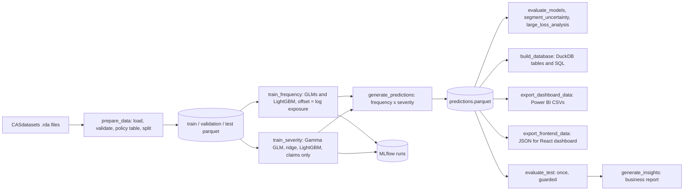

# Insurance claim frequency, severity and expected-cost modelling

A traditional machine-learning and actuarial pricing project on real French motor third-party liability data (`freMTPL2freq` / `freMTPL2sev` from the CASdatasets package). It predicts **claim frequency** (exposure-aware), **claim severity** (on claims only) and combines them into **expected annual claims cost**, compares classical GLMs with gradient boosting, explains the drivers, and exports results to SQL, MLflow, a React dashboard and Power BI-ready tables. No LLM or generative component is used.

## Headline results (held-out test set, evaluated once)

| Question | Result |
|---|---|
| Does the frequency model rank risk? | Yes. LightGBM Poisson: deviance 0.2374 vs 0.2412 (Poisson GLM) and 0.2529 (flat rate); Gini 0.321 vs 0.288 vs 0.002. The gain over the GLM is statistically reliable (difference -0.0038, 95% interval -0.0049 to -0.0030). |
| Is frequency calibrated? | Yes. Overall actual/predicted 1.004 (0.977-1.033); every risk segment's interval includes 1.0. |
| Is the expected cost *level* reliable? | **No.** Actual/expected cost is 0.813 (0.734-0.900): expected cost is about 23% above actual. Frequency is fine, so the gap is the severity level, which one ~4.1M claim in the training data inflates. |
| Can severity be predicted from the features? | Weakly at best. No severity model was reliably better than a constant on validation; on test the selected model is better, but partly through a lower overall level rather than demonstrated ranking skill. |

**Use the model to rank and compare risks. Do not use its absolute cost level for pricing without fixing the severity level.** Full detail, with uncertainty, is in `reports/business_insights.md` and the sections below. Expected claims cost is a pure-premium estimate of losses, not a customer price (expenses, commissions, capital, reinsurance and taxes are out of scope).

## Architecture



## Quick start

Declared support is Python 3.11+; the project was developed and verified on Python 3.13 (CI also uses 3.13). The dashboard needs Node 22.

```bash
python -m venv .venv && source .venv/bin/activate
pip install -e ".[dev]"
pytest                                          # unit tests (no dataset needed)

python -m scripts.prepare_data                  # downloads data to data/raw (git-ignored), builds splits
python -m scripts.run_eda                       # EDA on the training split
python -m scripts.train_frequency               # frequency models, validation metrics, MLflow runs
python -m scripts.train_severity                # severity models, bootstrap vs a constant
python -m scripts.generate_predictions          # expected-cost table for all splits
python -m scripts.evaluate_models               # segment performance (validation)
python -m scripts.segment_uncertainty           # bootstrap intervals for actual/expected
python -m scripts.explain_models                # SHAP and GLM relativities
python -m scripts.run_experiments               # monotone / GLM-boosted / Tweedie variants, PSI drift
python -m scripts.large_loss_analysis           # cap-and-load analysis
python -m scripts.build_database --query sql/analytics.sql   # DuckDB tables and example queries
python -m scripts.export_dashboard_data         # Power BI tables (see reports/dashboard_data/README.md)
python -m scripts.export_frontend_data          # JSON for the React dashboard
python -m scripts.evaluate_test                 # FINAL test evaluation, run once (refuses a second run without --force)
python -m scripts.generate_insights             # reports/business_insights.md
```

If the automatic download is blocked, fetch `freMTPL2freq.rda` and `freMTPL2sev.rda` from <https://github.com/dutangc/CASdatasets/tree/master/data> into `data/raw/`. Dashboard: `cd frontend && npm install && npm run dev` (see `frontend/README.md`). MLflow UI: `mlflow ui --backend-store-uri sqlite:///data/processed/mlflow.db`.

## Data and data dictionary

Source: R package CASdatasets (Dutang and Charpentier), French motor third-party liability portfolio, about 2011-2013; the package is GPL (>= 2) and the data are used here for research and education. Nothing from the raw data is committed. Details and limitations are in `data/README.md`.

| Column | Meaning |
|---|---|
| `IDpol` | Policy id; links the frequency and severity files |
| `ClaimNb` | Number of claims in the exposure period (outcome) |
| `Exposure` | Policy exposure in years (values above 1 are data errors and are capped at 1) |
| `VehPower`, `VehAge`, `DrivAge` | Vehicle power (ordered integer), vehicle age and driver age in years |
| `BonusMalus` | Bonus-malus score: 50 best, 100 neutral, above 100 malus |
| `VehBrand`, `VehGas` | Anonymised brand group (B1-B14) and fuel (Diesel / Regular) |
| `Area`, `Density`, `Region` | Anonymised density area code (A-F), inhabitants per km2, French region |
| `ClaimAmount` | Individual claim cost, one row per claim in the severity file (outcome) |

Facts that shape the modelling: 677,991 policies; 96.3% have no claim; frequency 0.074 per exposure-year; claim counts match the severity rows exactly; severity is extremely heavy-tailed (the top 0.1% of claims carry about a quarter of all claim cost); the data has **no date column**, so no out-of-time holdout is possible.

## Methodology

- **Frequency.** Claim counts are modelled with exposure as a log offset (GLMs) or log initial score (LightGBM), so a policy observed for half a year has half the expected claims. Models: constant rate, Poisson GLM, Negative Binomial GLM, LightGBM Poisson. Pearson dispersion of 1.89 indicates overdispersion; the Negative Binomial model changes point predictions very little.
- **Severity.** Modelled only on claims with a positive amount, so zero-claim policies never distort the conditional target. Models: constant mean, Gamma GLM (log link), claims-capped GLM, ridge Gamma GLM, LightGBM Gamma.
- **Expected cost.** `frequency (per exposure-year) x severity (per claim)` for a full year, plus the cost over the exposure actually observed for comparison with actuals. Non-finite or negative outputs raise an error instead of being clipped.
- **Split and leakage prevention.** A stratified random split by policy (60/20/20, seed fixed in `configs/config.yaml`) because there is no date to split on. Every policy is in exactly one split (asserted and tested); preprocessing and cap thresholds are learned on train only; actual outcomes live in separate columns from model inputs; the validation set drives early stopping and model selection; the test set was evaluated once after the choice was fixed, and `src/evaluation/holdout_guard.py` records that and blocks a repeat.
- **Evaluation.** Poisson deviance, MAE and Gini for frequency; Gamma deviance, MAE and RMSE for severity; decile and quintile calibration; actual-to-expected ratios by segment and feature group; bootstrap intervals for metric differences and for A/E ratios, because claim costs are heavy-tailed and differences are often within noise.

### Why GLMs matter, and when gradient boosting helps

GLMs are the actuarial baseline because they are transparent (each factor has an auditable multiplicative relativity), stable on small data, easy to file with regulators and to explain to underwriters, and statistically principled for counts and positive amounts. Gradient boosting is worth its extra complexity only when held-out data show a reliable gain. In this project it did for **frequency**: LightGBM beat the Poisson GLM on test deviance (0.2374 vs 0.2412) and ranking (Gini 0.321 vs 0.288), with the gain statistically reliable, at the price of lower interpretability (SHAP instead of coefficients). It did **not** for the refinements tried on validation: a monotone-constrained model lost a small but real amount of accuracy, boosting on a GLM gave no gain, and a direct Tweedie pure-premium model lost to frequency x severity. For **severity**, with about 16,000 heavy-tailed claims and weak signal, boosting did not reliably beat a constant, and the simple regularised GLM was the sensible choice.

## Repository structure

```
configs/config.yaml        paths, seed, features, split, model selection, MLflow settings
data/README.md             dataset source, license, dictionary, limitations (raw data not committed)
src/{data,features,models,evaluation,reporting,utils}/   loading and validation, split and preprocessing,
                           frequency / severity / pricing / large-loss models, metrics, uncertainty, drift,
                           holdout guard, dashboard and insights builders, config and MLflow helpers
scripts/                   the pipeline commands listed in the quick start
sql/{schema,analytics}.sql DuckDB tables, views and example queries
notebooks/                 four executed notebooks (exploration, frequency, severity, evaluation)
reports/                   result tables, figures, business_insights.md, Power BI tables
frontend/                  React dashboard (Vite + Recharts)
tests/                     pytest suite; .github/workflows/ci.yml runs lint, tests and the front-end build
```

## Responsible use and limitations

French data from about 2011-2013 with no dates (no out-of-time validation, no inflation adjustment); a limited feature set; a small, heavy-tailed severity sample whose level is driven by a few extreme claims; association, not causation, in every driver analysis; and expected cost is a loss estimate, not a price. Rating factors such as age raise fairness and regulatory questions that this project does not address. Natural next steps: a credibility-weighted or fitted-tail large-loss treatment, dated data for out-of-time validation and monitoring, and fresh data to re-check the cost level.

## Detailed validation results

Results below are from the validation split, which was used for model selection and early stopping (final test results are in their own section). Commands and file names refer to the quick start above.

Frequency models (actual run, `python -m scripts.train_frequency`; fit on train, scored on the validation split only, test untouched):

| Model | Split | Poisson deviance | MAE (counts) | Actual/Predicted | Gini |
|---|---|---|---|---|---|
| Constant rate | validation | 0.2524 | 0.0741 | 0.994 | -0.003 |
| Poisson GLM (log-exposure offset) | validation | 0.2395 | 0.0725 | 0.995 | 0.303 |
| Negative Binomial GLM (NB2, offset) | validation | 0.2396 | 0.0727 | 0.990 | 0.303 |
| LightGBM Poisson (log-exposure init score) | validation | 0.2338 | 0.0717 | 0.997 | 0.339 |

- LightGBM is best on validation (lower deviance, Gini 0.339 vs 0.303). Its train Gini is 0.378, so there is a train/validation gap (some overfitting); early stopping on validation chose 534 trees.
- Overdispersion: Poisson GLM Pearson dispersion is 1.89 on train and the estimated NB2 alpha is 1.05. Mean predictions are almost identical to the Poisson GLM, so NB gives no ranking or deviance gain here. Its validation log-likelihood is slightly better (-0.15697 vs -0.15717), which supports overdispersion mainly affecting uncertainty/standard errors rather than point predictions.
- The Poisson GLM lift table is in `reports/frequency_lift_validation_poisson_glm.csv`; LightGBM's is alongside it. These are validation results used for model selection, not final test results.

Severity models (actual run, `python -m scripts.train_severity`; trained on claims only: 15,872 train / 5,266 validation claims; test untouched):

| Model | Split | Gamma deviance | MAE | Actual mean | Predicted mean |
|---|---|---|---|---|---|
| Constant mean | validation | 1.669 | 2,281 | 2,143 | 2,438 |
| Gamma GLM (log link) | validation | 1.726 | 2,240 | 2,143 | 2,314 |
| Gamma GLM, claims capped at train p99.5 | validation | 1.698 | 1,746 | 2,143 | 1,691 |
| Ridge Gamma GLM (penalty chosen on validation) | validation | 1.664 | 2,187 | 2,143 | 2,310 |
| LightGBM (gamma objective) | validation | 1.656 | 2,131 | 2,143 | 2,241 |

Honest reading: severity is only weakly predictable from the available features.
- The Gamma GLM is *worse* than the constant mean on validation deviance (train 1.54 vs validation 1.73), i.e. it overfits with 16k claims.
  Its predicted-severity ranking is also not monotone (top predicted quintile has actual/predicted 0.57), so its relativities are not trustworthy as they stand.
- LightGBM beats the constant mean by only ~0.8% in deviance; I do not treat that as a real improvement without an uncertainty estimate.
- Capping lowers MAE because it predicts a lower mean, but it under-predicts average severity (actual/predicted 1.27), so it would need a large-loss load.
- RMSE is dominated by a few extreme claims (train RMSE ~37k vs validation ~11.6k because of a single claim of about 4.1M in train).
- Top-1% validation claims (about a third of total cost) are under-predicted by roughly 24-41x by every model, so a large-loss treatment is needed before pricing use.
Uncertainty (`reports/severity_bootstrap_vs_constant.csv`, 1,000 bootstrap resamples of validation claims; deviance minus the constant-mean deviance, negative = better):

| Model | Difference | 95% interval | Reliably different? |
|---|---|---|---|
| Gamma GLM | +0.057 | [-0.073, +0.182] | No |
| Gamma GLM, capped p99.5 | +0.030 | [-0.082, +0.148] | No |
| Ridge Gamma GLM | -0.005 | [-0.031, +0.026] | No |
| LightGBM | -0.012 | [-0.038, +0.017] | No |

No severity model is distinguishable from a constant mean on validation. The ridge search also chose the largest penalty on its grid (alpha=1.0, a boundary), i.e. the data pull the model toward a constant.
Practical implication: with these features, differences in expected claims cost across policies will be driven almost entirely by the frequency model; any severity relativities should be treated as unreliable.
Next step for severity: a large-loss/capped component and possibly a coarser, domain-driven set of severity factors.

## Expected claims cost (validation)

Selected models (fixed in `configs/config.yaml` from validation results, before any test-set evaluation): LightGBM Poisson for frequency; ridge Gamma GLM for severity (no severity model reliably beat a constant mean, so the most regularised interpretable one is used).
`python -m scripts.generate_predictions` writes a policy-level table (`data/processed/predictions.parquet`, not committed) with predicted frequency (per exposure-year), predicted severity, expected annual cost (= frequency x severity for a full year), expected cost over the observed exposure, a risk segment (quintiles of predicted annual cost, cut points from train only), and the actual outcomes in separate columns. Outputs that are non-finite or negative raise an error rather than being clipped. Expected claims cost is a pure-premium estimate of losses, not a customer price: expenses, commissions, capital, reinsurance and taxes are not modelled.

`python -m scripts.evaluate_models` (validation only), `reports/segment_performance_validation.csv`:

| Segment | Policies | Frequency actual/expected | Cost actual/expected | Actual pure premium | Expected pure premium |
|---|---|---|---|---|---|
| Very low | 27,087 | 1.012 | 1.210 | 101 | 84 |
| Low | 27,200 | 0.936 | 0.640 | 71 | 111 |
| Medium | 27,165 | 0.969 | 0.966 | 130 | 135 |
| High | 27,095 | 0.967 | 0.929 | 167 | 180 |
| Very high | 27,051 | 1.044 | 0.921 | 367 | 398 |

- Overall validation actual/expected cost is 0.925, but its 95% bootstrap interval is 0.79-1.08, which includes 1.0: the apparent 8% over-prediction is **within sampling noise**, not demonstrated miscalibration. The point estimate is consistent with the train mean claim (2,438, inflated by a single ~4.1M claim) being above the validation mean (2,143), but the data cannot confirm that explanation. Overall frequency A/E is 0.997 (0.969-1.024).
- Bootstrap intervals by segment (`python -m scripts.segment_uncertainty`, `python -m scripts.large_loss_analysis`, `python -m scripts.evaluate_test` (once), `reports/segment_ae_uncertainty_validation.csv`): only two ratios exclude 1.0. The "Low" segment's cost A/E of 0.640 (0.518-0.807) is a genuine over-prediction of cost; the "Very high" segment's frequency A/E of 1.044 (1.001-1.094) is a borderline under-prediction. Every other segment's frequency and cost ratio is consistent with 1.0, so the earlier segment-level deviations (e.g. Very low cost A/E 1.21) are mostly noise from few heavy-tailed claims (that interval is 0.68-1.95).
- Frequency is well calibrated (0.94-1.04) in every segment and in the driver-age, fuel and area groups checked (`reports/stability_by_feature_validation.csv`). Cost actual/expected varies much more by group (about 0.6-1.3) because it rests on few, heavy-tailed claims.
- The "Very high" segment has about 3.7x the actual pure premium of the "Very low"/"Low" segments, so the model separates risk, but ordering at the low end is not monotone (Low 71 < Very low 101) and should not be over-interpreted.
- Final test-set results are in the next section.

## SQL analytics (DuckDB)

`python -m scripts.build_database` builds `data/processed/claims.duckdb` (git-ignored) from the processed parquet files and report CSVs using `sql/schema.sql`: tables `policies`, `predictions`, `model_eval_frequency`, `model_eval_severity` and views `v_policy_features_targets`, `v_segment_performance` (actual vs expected loss by predicted risk segment) and `v_model_evaluation` (long-format metrics).
`python -m scripts.build_database --query sql/analytics.sql` runs the example queries in `sql/analytics.sql` (actual vs expected cost, segment performance, expected annual cost by area and region with sample sizes, driver-age frequency, model metrics). The views are covered by `tests/test_sql.py`.

## Explainability (frequency)

`python -m scripts.explain_models` (SHAP on a 5,000-policy validation sample for the LightGBM frequency model; relativities from the Poisson GLM refit on train). Outputs: `reports/frequency_shap_importance.csv`, `reports/frequency_glm_relativities.csv`, and figures in `reports/figures/`.

Mean |SHAP| on the log claim-rate scale: BonusMalus 0.356 (37% of total), DrivAge 0.118 (12%), Density 0.100, VehAge 0.092, Region 0.083, VehBrand 0.076, VehGas 0.073, VehPower 0.040, Area 0.013.

Poisson GLM rate relativities (95% interval), versus the base level of each factor (youngest driver band 18-21 for age; bonus-malus 100-125 for bonus-malus):
- Driver age: 25-30 has the lowest rate (0.48, 0.43-0.53); 21-25 and 30-40 are about 0.6; 40+ bands are about 0.8-0.85. Younger drivers have clearly higher claim rates.
- Bonus-malus: the best bonus band (50) is 0.14 (0.13-0.15) of the base rate, rising steadily with the score to 0.44 for 80-100; the highest malus band (125-150) is 1.30 (1.06-1.61), a wide interval because of few policies.
- Regular fuel vs diesel: 0.86 (0.83-0.89). Log density has a small effect (1.04, interval just touches 1, p=0.052), and Area carries little extra information beyond density and region (lowest SHAP).

These are statistical associations in observational data, not causal effects. Bonus-malus and driver age partly proxy for each other and for claims history, so importance should not be read as "changing this factor changes risk". The SHAP and GLM views agree on direction, which is reassuring but not proof. No explainability has been done for the severity model: no severity model was reliably better than a constant, so there is nothing meaningful to explain there.

## Experiment tracking (MLflow)

`train_frequency` and `train_severity` log one MLflow run per model to a local SQLite store (`data/processed/mlflow.db`, git-ignored; no remote server or credentials): parameters (model hyperparameters, feature lists, split config, NB/ridge alpha), a hash of the training data, train and validation metrics, the seed, and a `selected` tag that marks the model chosen in `configs/config.yaml`. Experiments are `claim-frequency` (4 runs) and `claim-severity` (5 runs). Browse with `mlflow ui --backend-store-uri sqlite:///data/processed/mlflow.db`. Re-running the scripts with the fixed seed reproduced identical report CSVs. Model binaries are not logged to MLflow or committed; `generate_predictions` writes the selected models to `models/` (git-ignored).

## Modern variants tried (validation only)

`python -m scripts.run_experiments` evaluates four techniques common in current actuarial ML against the selected models. Results are on the validation split; the test split was not read. None changed the model selection.

| Experiment | Result |
|---|---|
| Monotone-constrained LightGBM (BonusMalus non-decreasing) | Poisson deviance 0.2358 vs 0.2338 (difference +0.0020, 95% bootstrap interval 0.0016-0.0023); Gini 0.329 vs 0.339. The constraint costs a small but real amount of accuracy; the price of a guaranteed-sensible bonus-malus relativity. |
| GLM-boosted LightGBM (boosting on a Poisson GLM offset) | Deviance 0.2342 vs 0.2338 (+0.0003, interval 0.0001-0.0006); Gini 0.3365. No gain over plain LightGBM. |
| Direct Tweedie LightGBM pure-premium model (p = 1.3 / 1.5 / 1.7) | Tweedie deviance 80.3 / 80.1 / 80.3 vs 79.1 for frequency x severity; cost Gini 0.296 / 0.303 / 0.299 vs 0.322. The two-part pipeline wins on both; Tweedie models under-predict aggregate cost (actual/expected 1.06-1.13) where the pipeline over-predicts (0.92). |
| PSI drift (train vs validation) | All features and predictions below 0.001 (stable). Expected: the splits are random draws from one population and there is no time dimension, so this is a sanity check and a baseline for future monitoring, not evidence about real drift. |

Takeaway: on this data the plain two-part LightGBM x ridge-GLM pipeline is hard to beat with these refinements, and the constraint is an explainability-for-accuracy trade, not a free improvement. Outputs: `reports/frequency_variants_validation.csv`, `reports/pure_premium_variants_validation.csv`, `reports/drift_psi_train_vs_val.csv`.

## Notebooks

`notebooks/` holds four executed notebooks with the results saved in them: `01_data_exploration` (train split only; validation and test are inspected for risk features only), `02_frequency_modeling` and `03_severity_modeling` (fit on train, compared on validation, never reading the test split), and `04_model_evaluation` (reads only the saved result tables, including the one-time test results, and never refits). `tests/test_notebooks.py` checks that each notebook is executed and error-free and enforces those holdout rules, so a notebook cannot quietly start using the test set. Re-run them with `jupyter nbconvert --to notebook --execute --inplace notebooks/<name>.ipynb` after the pipeline scripts.

## Front-end dashboard (React)

A React dashboard lives in `frontend/` (branch `frontend`): five tabs covering the executive overview, risk analysis, model performance, risk drivers and monitoring. It reads aggregates exported by `python -m scripts.export_frontend_data` (validation split only) and is covered by front-end tests and a CI workflow (`.github/workflows/ci.yml`). See `frontend/README.md`.

## Final test-set results

`python -m scripts.evaluate_test` was run **once**, after the model choice was fixed in `configs/config.yaml` from validation results (`src/evaluation/holdout_guard.py` records the use in `reports/test_evaluation_marker.json` and refuses a second run without `--force`). Models were fitted on train; baselines were refit on train; nothing was tuned on the test set. Disclosure: before this run I saw one test aggregate (cost actual/expected 0.813) in an early SQL query; no model or selection was changed because of it. Outputs: `reports/test_results.csv`, `reports/test_segment_performance.csv`.

**Frequency** (135,599 test policies; bootstrap intervals for the deviance difference of the selected model minus the comparison, negative = selected is better):

| Model | Poisson deviance | Gini | Actual/predicted | Selected model's deviance difference (95% interval) |
|---|---|---|---|---|
| Constant rate | 0.2529 | 0.002 | 1.003 | -0.0155 (-0.0172 to -0.0140) |
| Poisson GLM | 0.2412 | 0.288 | 1.003 | -0.0038 (-0.0049 to -0.0030) |
| LightGBM Poisson (selected) | 0.2374 | 0.321 | 1.004 | |

LightGBM is reliably better than both baselines on held-out data. Its Gini (0.321) is below the validation figure (0.339), the usual optimism from selecting on validation. Overall frequency A/E is 1.004 (0.977-1.033) and every risk segment's frequency interval includes 1.0, so frequency is well calibrated.

**Severity** (test claims): ridge Gamma GLM deviance 1.4351 vs constant mean 1.4677; difference -0.0326 (-0.0476 to -0.0149). The selected model is reliably better than the constant on this sample, unlike on validation. Caution: its predicted mean (2,305) is lower than the constant's (2,438) and closer to the test mean (1,871), so part of the gain reflects a lower overall level rather than better risk ranking; the two cannot be separated from these numbers.

**Expected cost: a real weakness.** Overall test cost A/E is **0.813 (0.734-0.900)**; the interval excludes 1.0. Expected pure premium is 170 per exposure-year vs 139 actual: expected is about 23% above actual (equivalently, actual is 19% below expected). Frequency is calibrated (A/E 1.004), so the gap is the severity level: predicted mean severity 2,305 vs actual 1,871 on test claims. Validation showed the same direction (0.925, interval including 1.0), and train the opposite (A/E 1.055): the training claims contain one ~4.1M claim, which inflates the severity level the model learns, so the overall level is driven by one claim and is not stable across samples. By segment, cost A/E is below 1.0 in all five segments (Very low 0.61, Low 0.81, Medium 0.89, High 0.80, Very high 0.86) with Very low, Low and High excluding 1.0. These expected costs should not be used as pricing levels without fixing the severity level (see the large-loss section); the **relative** ranking of risk is the part supported by the evidence.

## Large-loss treatment (cap and load)

`python -m scripts.large_loss_analysis` (fit on train, validation only; `reports/large_loss_analysis_validation.csv`) models severity on claims capped at a train quantile, then multiplies by a portfolio-wide load for the excess above the cap (`src/models/large_loss.py`).

| Cap (train quantile) | Load | Load without the single largest claim | Share of all excess from that one claim | Cost A/E, capped only | Cost A/E, capped + load |
|---|---|---|---|---|---|
| p99 (16,790) | 54.9% | 38.7% | 29.6% | 1.36 (1.17-1.59) | 0.88 (0.75-1.03) |
| p99.5 (34,693) | 43.9% | 28.9% | 34.2% | 1.26 (1.08-1.47) | 0.88 (0.75-1.03) |
| p99.9 (156,057) | 25.0% | 12.4% | 50.7% | 1.10 (0.94-1.28) | 0.88 (0.76-1.03) |

- Capping alone clearly under-predicts total cost (intervals exclude 1.0 for p99 and p99.5), confirming that the tail carries a large share of loss cost.
- Adding the load restores the training mean by construction, so cost A/E is 0.88 (interval includes 1.0), no better than the existing 0.925 once uncertainty is considered.
- The load is **unstable**: one ~4.1M claim contributes 30-50% of the total excess, and dropping it would cut the load by roughly a third or more. I did not drop it (that would be tuning on an outcome); the practical conclusion is that a large-loss load estimated from this sample is unreliable and would need credibility weighting, a fitted tail distribution (e.g. Pareto) or reinsurance-style treatment before pricing use. The model selection is unchanged.

All model results above are validation results used for model selection; final test-set results are reported in their own section.

Data checks and EDA findings (from actual runs, train split only):
- 677,991 policies, no missing values or duplicate ids; 1,224 have exposure > 1 (capped at 1).
- Claim counts in the frequency file match the severity rows exactly, so the two files join cleanly.
- 96.3% of train policies have zero claims; overall frequency 0.0738 per exposure-year.
- Raw var/mean of claim counts is 1.11 (ignores exposure and covariates); overdispersion is still to be tested on fitted models.
- Severity is heavy-tailed: median 1,172, p99.9 156,057, max 4,075,401; the top 0.1% of claims make up 25.9% of total claim amount.
- Train/val/test frequencies are close (0.0738 / 0.0734 / 0.0741). See `reports/eda_summary.txt` and `reports/figures/`.

See `data/README.md` for dataset source, license and limitations.
